# Arquitetura do Sistema — Restaurante Micaxu (Landing Page & Cardápio Digital)

Este documento define a arquitetura técnica, árvore de componentes, schema de dados, estratégia de SEO local e a divisão de trabalho entre as frentes de desenvolvimento para a landing page e cardápio digital do **Restaurante Micaxu** (Boituva/SP), com base na especificação oficial contida em `docs/SPEC.md`.

> Atualização de apresentação (17/10/2026): o site não exibe preços, totalizadores, legenda M/I, avisos de alteração ou consultas de preço, inclusive em SEO/JSON-LD. Os valores permanecem no catálogo de dados para preservar seus contratos e validações. O montador de caipirinha mantém as escolhas e o resumo da combinação, sem total.

---

## 1. Stack Tecnológica e Decisões de Engenharia

| Camada / Ferramenta | Tecnologia Escolhida | Justificativa Técnica |
| :--- | :--- | :--- |
| **Framework Web** | **Next.js 14+ (App Router)** | Roteamento moderno, renderização estática otimizada, excelente suporte a SEO e Metadados. |
| **Modo de Saída** | **Static Export (`output: 'export'`)** | Gera artefatos HTML/CSS/JS estáticos puros (`/out`), permitindo hospedagem de altíssima velocidade e custo zero (Vercel, Cloudflare Pages, Firebase Hosting, Nginx, etc.), com `images: { unoptimized: true }`. |
| **Linguagem** | **TypeScript (Strict Mode)** | Tipagem estática rigorosa para garantir 100% de conformidade com os preços, categorias e itens descritos no cardápio do `SPEC.md`. |
| **Estilização** | **Tailwind CSS** | Design responsivo mobile-first, identidade vinho: primária `#773b3b`, secundária `#804e47`, fundo `#5c3f36`; superfícies derivadas e texto creme com contraste AA. Tokens CSS compartilhados com Tailwind, glassmorphism e microinterações. |
| **Animações** | **Framer Motion** | Transições de abas via `layoutId`, scroll reveal suave, microinterações em botões e suporte nativo ao respeito a `prefers-reduced-motion`. |
| **Ícones** | **Lucide React** | Biblioteca vetorial leve, consistente e personalizável para gastronomia, horários, localização e status. |
| **Utilitários** | **clsx + tailwind-merge** | Composição segura de classes utilitárias via helper `cn()`. |

Tipografia: Playfair Display nos títulos e Inter no corpo, via `next/font/google`. CTAs de localização usam creme sobre vinho; WhatsApp usa `#25D366` com texto escuro. Imagens da interface são locais, fornecidas por `src/data/images.ts`, sem placeholders externos; categorias sem foto fiel não recebem imagem.

---

## 2. Árvore de Diretórios do Projeto

Organização modular baseada em responsabilidades bem delineadas:

```text
micaxu/
├── docs/
│   ├── SPEC.md                      # Fonte da verdade (requisitos e cardápio)
│   └── ARCHITECTURE.md              # Este documento de arquitetura
├── public/
│   ├── favicon.ico                  # Favicon do restaurante
│   ├── og-image.jpg                 # Imagem para OpenGraph / compartilhamento
│   └── images/
│       ├── hero/                    # Imagens de capa de alta resolução
│       ├── buffet/                  # Imagens do buffet diário
│       └── instagram/               # Imagens locais do feed / pratos
├── scripts/
│   └── fetch-instagram.mjs          # Script auxiliar de extração/download (Node.js)
├── src/
│   ├── app/
│   │   ├── layout.tsx               # Root Layout com fontes, SEO base e Schema JSON-LD
│   │   ├── page.tsx                 # Página principal única (Landing Page)
│   │   ├── globals.css              # Diretivas Tailwind, variáveis CSS e efeitos glass
│   │   ├── robots.txt               # Diretivas para motores de busca
│   │   └── sitemap.ts               # Sitemap estático para indexação
│   ├── components/
│   │   ├── layout/
│   │   │   ├── Navbar.tsx           # Barra de navegação fixa com efeito vidro (glassmorphism)
│   │   │   └── Footer.tsx           # Rodapé institucional, mapa, horários e redes
│   │   ├── sections/
│   │   │   ├── Hero.tsx             # Banner principal com chamada, badges e CTAs
│   │   │   ├── InfoBanner.tsx       # Faixa de informações críticas (ordem de chegada, sem reserva, kg)
│   │   │   ├── Buffet.tsx           # Destaque do buffet variado e almoço por kg
│   │   │   ├── Menu/
│   │   │   │   ├── MenuSection.tsx  # Wrapper do cardápio com orquestração de filtros
│   │   │   │   ├── MenuTabs.tsx     # Abas de categorias animadas com Framer Motion
│   │   │   │   ├── MenuSearch.tsx   # Barra de busca interativa em tempo real
│   │   │   │   ├── MenuItemCard.tsx # Card de exibição do prato/bebida (preços M/I e variantes)
│   │   │   │   └── PortionSaucesList.tsx # Bloco de adicionais de molho para porções
│   │   │   ├── CaipirinhaBuilder.tsx# Simulador interativo "Monte sua Caipirinha" e especiais
│   │   │   └── InstagramGallery.tsx # Grade de fotos do Instagram com fallback Unsplash
│   │   └── ui/
│   │       ├── OpenStatusBadge.tsx  # Badge em tempo real "Aberto Agora" / "Fechado no momento"
│   │       ├── WhatsAppFAB.tsx      # Botão flutuante de atendimento WhatsApp com microinteração
│   │       ├── SectionTitle.tsx     # Componente padronizado para títulos de seção
│   │       └── GlassCard.tsx        # Container com fundo translúcido e bordas sutis
│   ├── data/
│   │   ├── menuData.ts              # 100% dos dados brutos do cardápio (fiel ao SPEC)
│   │   ├── restaurantInfo.ts        # Dados de contato, links, endereço e horários
│   │   └── instagramPosts.ts        # Feed de imagens e URLs de fallback Unsplash
│   ├── hooks/
│   │   ├── useOpenStatus.ts         # Hook reativo com cálculo de fuso horário de Brasília
│   │   └── useMenuFilter.ts         # Hook para filtragem por categoria e termo de pesquisa
│   ├── types/
│   │   └── menu.ts                  # Schemas e interfaces TypeScript
│   └── utils/
│       ├── businessHours.ts         # Regras de negócio de dia/horário de funcionamento
│       └── cn.ts                    # Utilitário para concatenação condicional de classes
├── next.config.mjs
├── tailwind.config.ts
├── tsconfig.json
└── package.json
```

---

## 3. Árvore de Componentes e Fluxo Visual

A landing page opera como uma Single Page Application otimizada para mobile e desktop:

```mermaid
graph TD
    App[RootLayout: layout.tsx] --> Page[Page: page.tsx]
    
    Page --> Navbar[Navbar (Fixed Glassmorphism)]
    Navbar --> NavBadge[OpenStatusBadge (Compacto)]
    Navbar --> NavLinks[Links de Navegação / Âncoras]
    Navbar --> NavCTA[CTA WhatsApp Rápido]

    Page --> Hero[Hero Section]
    Hero --> HeroBG[Background com zoom sutil]
    Hero --> HeroCTA[Botões: Cardápio / Como Chegar]

    Page --> InfoBanner[InfoBanner Section]
    InfoBanner --> OrderBadge["Badge: Ordem de Chegada"]
    InfoBanner --> NoReserve["Badge: Não Fazemos Reservas!"]
    InfoBanner --> KgPrice["Destaque: Almoço por Kg R$ 119,90"]
    InfoBanner --> StatusCard["Card: Aberto Agora / Fechado"]
    StatusCard --> OpenStatusBadge

    Page --> Buffet[Buffet Section]
    Buffet --> BuffetDesc[Texto institucional & variedade]
    Buffet --> BuffetVisual[Galeria / Destaque de pratos]

    Page --> MenuSection[MenuSection]
    MenuSection --> MenuSearch[MenuSearch (Busca instantânea)]
    MenuSection --> MenuTabs[MenuTabs (Categorias animadas)]
    MenuSection --> PortionSaucesList[PortionSaucesList (Molhos R$ 3,90)]
    MenuSection --> MenuGrid[Grid de MenuItemCard]
    MenuGrid --> MenuItemCard[MenuItemCard (Preços M/I, único, variantes, notas)]

    Page --> CaipirinhaBuilder[CaipirinhaBuilder]
    CaipirinhaBuilder --> StepFruit[Passo 1: Seleção de Fruta]
    CaipirinhaBuilder --> StepSpirit[Passo 2: Seleção de Destilado + Cálculo]
    CaipirinhaBuilder --> SpecialsGrid[Grid de Caipirinhas Especiais]

    Page --> InstagramGallery[InstagramGallery]
    InstagramGallery --> GridPhotos[Grid 3x2 ou 4x2 com Fallback]
    InstagramGallery --> FollowCTA[Botão Siga @restaurantemicaxu]

    Page --> Footer[Footer]
    Footer --> MapEmbed[Localização & Google Maps]
    Footer --> BusinessSchedule[Tabela de Horários]
    Footer --> SocialLinks[WhatsApp / Instagram]

    Page --> WhatsAppFAB[WhatsAppFAB (Fixo flutuante)]
```

### Especificação dos Componentes Centrais

1. **`Navbar`**:
   - Fixa no topo (`sticky` ou `fixed top-0 z-50`).
   - Efeito vidro (`backdrop-blur-md bg-stone-950/80 border-b border-amber-900/20`).
   - Contém logo, links de rolagem suave (`#buffet`, `#cardapio`, `#caipirinhas`, `#localizacao`), badge resumido de status e botão de ação rápida.

2. **`OpenStatusBadge`**:
   - Calcula em tempo real com base no fuso `America/Sao_Paulo`.
   - Exibe indicador verde pulsante para "Aberto Agora" e âmbar/cinza para "Fechado no momento".
   - Exibe informação complementar do próximo horário de abertura/fechamento.

3. **`InfoBanner`**:
   - Destaque em tom dourado/terroso contrastante.
   - Comunica com clareza inegociável as duas regras de atendimento: **ORDEM DE CHEGADA** e **NÃO FAZEMOS RESERVAS**.
   - Destaca o valor do Buffet por Kg (R$ 119,90) com o aviso "sujeito à alteração".

4. **`MenuSection` + `MenuTabs` + `MenuSearch`**:
   - Abas: *Porções, Cervejas, Refrigerantes, Sucos & Chás, Drinks & Doses, Energéticos*.
   - Transição com Framer Motion (`layoutId="activeTab"`).
   - Campo de busca instantâneo que filtra por nome do item ou ingredientes/variantes.
   - Renderização limpa para itens de preço duplo (M/I) com legenda clara no topo da aba.

5. **`CaipirinhaBuilder`**:
   - Passo 1 (Fruta): Limão, Kiwi, Morango.
   - Passo 2 (Destilado): Pinga (R$ 35,00), Cachaça (R$ 40,00), Vodka (R$ 40,00), Gin (R$ 50,00).
   - Totalizador animado que exibe o valor conforme a combinação do cliente.
   - Seção anexa com as Caipirinhas Especiais (Cerveja R$ 49,00; Cachaça com Rúcula e Pimenta R$ 49,00).

6. **`WhatsAppFAB`**:
   - Posição fixa no canto inferior direito (`fixed bottom-6 right-6 z-40`).
   - Microanimação de atenção (pulso suave ou balanço a cada intervalo de tempo).
   - Ao clicar, redireciona diretamente para `https://wa.me/+5515974017775` com mensagem pré-preenchida.

---

## 4. Schema TypeScript do `menuData`

O arquivo `src/types/menu.ts` modela com exatidão todas as variações de preços e estruturas presentes no cardápio do `SPEC.md`:

```typescript
// src/types/menu.ts

export type MenuCategoryId =
  | 'porcoes'
  | 'cervejas'
  | 'refrigerantes'
  | 'sucos-chas'
  | 'drinks-doses'
  | 'energeticos'
  | 'caipirinhas';

export interface MenuCategory {
  id: MenuCategoryId;
  title: string;
  icon: string;
  description?: string;
  note?: string;
}

// Modelagem discriminada para precificação
export type PriceModel =
  | {
      type: 'dual';             // Porções com Média e Inteira
      priceMedia: number;       // Ex: 45.00
      priceInteira: number;     // Ex: 68.00
    }
  | {
      type: 'single';           // Preço único fixo
      price: number;            // Ex: 40.00
      note?: string;            // Ex: "(500g)", "(10 un.)", "(Copo)"
    }
  | {
      type: 'consult';          // Itens sob consulta
      price?: number;           // Ex: 30.00 (IPA Weiss)
      note: string;             // Ex: "Consulte-nos"
    };

export interface MenuItem {
  id: string;
  categoryId: MenuCategoryId;
  name: string;
  description?: string;
  volumeOrServing?: string;     // Ex: "330ml", "600ml", "Lata 350ml", "KS 290ml", "12 un."
  pricing: PriceModel;
  variants?: string[];          // Ex: ["Cola", "Cola Zero", "Guaraná"] ou sabores de suco
  highlight?: boolean;          // Destaque visual (ex: Tilápia, Torresmo)
  isAvailable?: boolean;        // Controle de disponibilidade
}

// Adicionais de Molho específicos para Porções
export interface SauceAddon {
  id: string;
  name: string;                 // "Molho Rosé", "Molho de Alho", "Molho Mostarda", "Wasabi"
  price: number;                // 3.90
}

// Tipagem para o Simulador de Caipirinhas
export interface CaipirinhaFruit {
  id: string;
  name: string;                 // "Limão", "Kiwi", "Morango"
}

export interface CaipirinhaSpirit {
  id: string;
  name: string;                 // "Pinga", "Cachaça", "Vodka", "Gin"
  price: number;                // 35.00, 40.00, 40.00, 50.00
}

export interface CaipirinhaSpecial {
  id: string;
  name: string;                 // "Caipirinha de Cerveja", "Caipirinha de Cachaça com Rúcula e Pimenta"
  price: number;                // 49.00
  description?: string;
}

export interface CaipirinhaConfig {
  fruits: CaipirinhaFruit[];
  spirits: CaipirinhaSpirit[];
  specials: CaipirinhaSpecial[];
}

// Estrutura global do MenuData
export interface RestaurantMenuData {
  categories: MenuCategory[];
  items: MenuItem[];
  sauces: SauceAddon[];
  caipirinhaBuilder: CaipirinhaConfig;
  buffetInfo: {
    pricePerKg: number;         // 119.90
    note: string;               // "sujeito à alteração"
    title: string;
    description: string;
  };
}
```

---

## 5. Estratégia de SEO Local & Rich Snippets

Para assegurar posicionamento orgânico em buscas como *"restaurante em Boituva"*, *"buffet por quilo Boituva"*, *"onde comer peixe em Boituva"*:

### 5.1 Metadata API (Next.js `layout.tsx`)
- **Title**: `Restaurante Micaxu | Buffet por Kg, Peixes e Porções em Boituva/SP`
- **Description**: `Almoço com buffet variado por Kg (R$ 119,90), porções generosas de peixes e frutos do mar, cervejas trincando e caipirinhas artesanais no centro gastronômico de Boituva. Atendimento por ordem de chegada.`
- **Keywords**: `Restaurante Micaxu, Restaurante Boituva, Buffet por quilo Boituva, Porções de tilápia Boituva, Frutos do mar Boituva, Almoço Boituva SP, Onde comer em Boituva`.
- **OpenGraph & Twitter Card**:
  - `og:title`, `og:description`, `og:url` (`https://restaurantemicaxu.com.br`), `og:siteName`: `Restaurante Micaxu`
  - `og:locale`: `pt_BR`
  - `og:type`: `restaurant.restaurant`
  - `og:image`: `/og-image.jpg` (dimensões 1200x630px com foto atrativa do buffet/pratos e logo)
- **Canonical**: URL canônica definida no `metadataBase`.

### 5.2 JSON-LD Estruturado (`schema.org/Restaurant`)
Inserido diretamente em `<script type="application/ld+json">` dentro do `<head>` no `layout.tsx`:

```json
{
  "@context": "https://schema.org",
  "@type": "Restaurant",
  "@id": "https://restaurantemicaxu.com.br/#restaurant",
  "name": "Restaurante Micaxu",
  "image": "https://restaurantemicaxu.com.br/images/hero/hero-micaxu.jpg",
  "description": "Buffet por Kg variado e saboroso, porções generosas de peixes, frutos do mar e bebidas geladas em Boituva/SP. Atendimento por ordem de chegada.",
  "servesCuisine": ["Brasileira", "Frutos do Mar", "Buffet", "Porções"],
  "priceRange": "$$",
  "telephone": "+55-15-97401-7775",
  "acceptsReservations": false,
  "address": {
    "@type": "PostalAddress",
    "streetAddress": "R. José Moschioni, 440",
    "addressLocality": "Boituva",
    "addressRegion": "SP",
    "postalCode": "18550-000",
    "addressCountry": "BR"
  },
  "geo": {
    "@type": "GeoCoordinates",
    "latitude": -23.2847,
    "longitude": -47.6789
  },
  "url": "https://restaurantemicaxu.com.br",
  "hasMap": "https://maps.app.goo.gl/EVmeigmwBFuHtL1P9?g_st=ac",
  "openingHoursSpecification": [
    {
      "@type": "OpeningHoursSpecification",
      "dayOfWeek": ["Tuesday", "Wednesday", "Thursday", "Friday"],
      "opens": "11:30",
      "closes": "15:00"
    },
    {
      "@type": "OpeningHoursSpecification",
      "dayOfWeek": ["Saturday", "Sunday"],
      "opens": "11:30",
      "closes": "17:00"
    }
  ],
  "sameAs": [
    "https://www.instagram.com/restaurantemicaxu/",
    "https://wa.me/+5515974017775"
  ]
}
```

> **Aviso Chave de SEO**: A propriedade `"acceptsReservations": false` é fundamental para alimentar os assistentes do Google e evitar conflitos com a regra de atendimento por ordem de chegada do restaurante.

---

## 6. Imagens Reais do Restaurante

O rebranding substitui as imagens ilustrativas por arquivos reais fornecidos do Instagram.

- Originais preservados em `/public/images/restaurantemicaxu/`.
- `npm run images:optimize` executa `scripts/optimize-images.mjs` com Sharp e gera WebP qualidade 80, sem ampliar, com no máximo 1600px em cada dimensão, em `/public/images/optimized/`.
- O script registra a classificação visual dos 19 originais: dois pratos, sete fotos de buffet, duas fotos de ambiente, duas artes sobre fachada, dois logos (um avatar) e quatro miniaturas de destaques. O avatar, as miniaturas e as artes de avisos não entram no catálogo web.
- A imagem PNG de 14,6MB é uma sessão de fotos de porções na mesa. Sua versão otimizada tem aproximadamente 180KB. Recortes dessa foto mostram cervejas e suco de laranja reais, sem ampliação.
- `img.png` é o logo branco com transparência, não uma imagem corrompida.

`src/data/images.ts` exporta `RestaurantImage` com `id`, `src`, `alt`, `category`, `orientation`, `width` e `height`; o mapa `restaurantImages`; `heroImage`, `buffetImage`, `logoImage`; `galleryImages`; e `menuCategoryImages`, um `Partial<Record<MenuCategoryId, RestaurantImage>>`.

Apenas porções, cervejas e águas/sucos/chás possuem imagem de categoria fiel. Não foi fornecida foto exclusiva confirmada de camarão, torresmo ou caipirinha. `caipirinhaImage` é `undefined`; a UI deve omitir a foto, nunca substituir por outro prato ou bebida.

`src/data/instagramPosts.ts` deriva do catálogo real e mantém links para o perfil oficial. Os campos legados `image` e `fallbackImage` apontam ao mesmo arquivo local por compatibilidade, sem URLs externas.

`scripts/fetch-instagram.mjs` continua opcional; arquivos baixados vão para o diretório de originais e exigem revisão visual antes de inclusão no catálogo. Não dependemos da disponibilidade do Instagram no cliente.

---

## 7. Divisão de Responsabilidades (Zero Sobreposição de Arquivos)

Para evitar conflitos de merge entre o **Programador** e o **Frontend Designer**, cada arquivo possui titularidade exclusiva:

```mermaid
graph LR
    subgraph Programador["Programador (Lógica, Dados, Tipos, Hooks e Configurações)"]
        P1["package.json / tsconfig.json"]
        P2["next.config.mjs / tailwind.config.ts"]
        P3["src/types/menu.ts"]
        P4["src/data/menuData.ts"]
        P5["src/data/restaurantInfo.ts"]
        P6["src/data/instagramPosts.ts"]
        P7["src/utils/businessHours.ts & cn.ts"]
        P8["src/hooks/useOpenStatus.ts & useMenuFilter.ts"]
        P9["scripts/fetch-instagram.mjs"]
    end

    subgraph Designer["Frontend Designer (UI, Layout, Estilização e Animações)"]
        D1["src/app/globals.css"]
        D2["src/app/layout.tsx & page.tsx"]
        D3["src/components/layout/Navbar.tsx & Footer.tsx"]
        D4["src/components/sections/Hero.tsx & InfoBanner.tsx"]
        D5["src/components/sections/Buffet.tsx"]
        D6["src/components/sections/Menu/* (MenuSection, Tabs, Search, ItemCard)"]
        D7["src/components/sections/CaipirinhaBuilder.tsx"]
        D8["src/components/sections/InstagramGallery.tsx"]
        D9["src/components/ui/* (OpenStatusBadge, WhatsAppFAB, etc.)"]
    end

    Programador -->|Fornece dados e hooks| Designer
```



### Matriz de Atribuição por Arquivo

| Arquivo | Responsável | Escopo e Obrigações |
| :--- | :--- | :--- |
| `src/types/menu.ts` | **Programador** | Schemas TypeScript rigorosos, união discriminada de preços e filtros. |
| `src/data/menuData.ts` | **Programador** | Transcrição de 100% dos pratos, bebidas, molhos e valores do `SPEC.md` sem omissões. |
| `src/data/restaurantInfo.ts` | **Programador** | Dados institucionais, telefones, links, regras de horário e coordenadas. |
| `src/data/instagramPosts.ts` | **Programador** | Coleção de posts com links oficiais e URLs de fallback Unsplash calibradas. |
| `src/utils/businessHours.ts` | **Programador** | Lógica pura de cálculo de horário de funcionamento (`America/Sao_Paulo`). |
| `src/hooks/useOpenStatus.ts` | **Programador** | Hook de ciclo de vida para atualização reativa do status Aberto/Fechado. |
| `src/hooks/useMenuFilter.ts` | **Programador** | Hook com memoização para busca textual e filtragem por abas do cardápio. |
| `scripts/fetch-instagram.mjs` | **Programador** | Script autônomo Node.js para coleta de fotos públicas. |
| `src/app/globals.css` | **Frontend Designer** | Configuração de variáveis CSS, temas, classes de vidro (`glassmorphism`) e reset. |
| `src/app/layout.tsx` | **Frontend Designer** | Montagem do HTML raiz, inclusão de fontes, metadados SEO e script JSON-LD. |
| `src/app/page.tsx` | **Frontend Designer** | Orquestração sequencial de todas as seções da landing page. |
| `src/components/layout/*` | **Frontend Designer** | Implementação visual da `Navbar` e do `Footer`. |
| `src/components/sections/*` | **Frontend Designer** | Implementação estética e animações de `Hero`, `InfoBanner`, `Buffet`, `Menu`, `CaipirinhaBuilder` e `InstagramGallery`. |
| `src/components/ui/*` | **Frontend Designer** | Estilização dos micro-componentes `OpenStatusBadge`, `WhatsAppFAB`, títulos e cards. |

---

## 8. Critérios de Aceite e Verificação

1. **Fidelidade Integral ao Cardápio**:
   - Todas as 14 porções com preços M/I conferem exatamente com a tabela da especificação.
   - Todas as 8 porções somente inteira estão contempladas com valores corretos.
   - Os 4 adicionais de molho a R$ 3,90 estão visíveis na aba de porções.
   - Cervejas Long Neck e 600ml, refrigerantes lata/KS/IT, sucos, chás, águas, drinks prontos, doses e energéticos correspondem integralmente ao `SPEC.md`.
2. **Regras Operacionais em Destaque**:
   - Os avisos de **Ordem de Chegada** e **Não Fazemos Reservas** são evidentes sem necessidade de rolagem excessiva.
   - O preço do buffet (R$ 119,90) apresenta o disclaimer de alteração de valor.
3. **Comportamento do Badge de Horário**:
   - Segunda-feira: "Fechado no momento".
   - Terça a Sexta: "Aberto Agora" entre 11h30 e 15h00 (horário de Brasília).
   - Sábados, Domingos e Feriados: "Aberto Agora" entre 11h30 e 17h00.
4. **Animações e Acessibilidade**:
   - Transição suave entre abas do cardápio sem quebra de layout.
   - `prefers-reduced-motion` respeitado para usuários com sensibilidade visual.
5. **Build Estático e Performance**:
   - `npm run build` deve executar com sucesso gerando exportação estática pura.
   - Sem erros de hidratação ou referências nulas no SSR/SSG.
